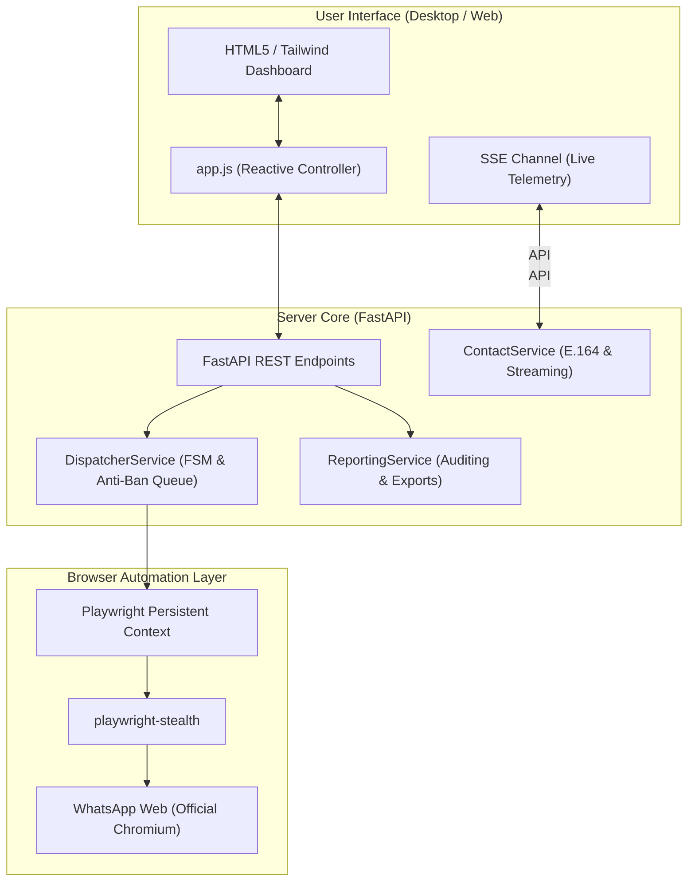

# WhatsApp Sender Engine 🚀

<div align="center">

[](https://www.python.org/)
[](https://fastapi.tiangolo.com/)
[](https://playwright.dev/)
[](LICENSE)
[]()

**Professional, decoupled WhatsApp Web automation engine for bulk messaging featuring biomechanical human typing simulation, stochastic anti-ban protection (Box-Muller jitter), resilient session persistence, and high-performance streaming spreadsheet ingestion.**

[🇧🇷 Português](README.md) • [🇺🇸 English](README.en.md)

</div>

---

## 📌 Why WhatsApp Sender Engine?

Most bulk WhatsApp senders in the market fail due to structural flaws:
1. **Immediate Meta Bans:** Dispatches with static, robotic intervals (e.g., exactly every 5 seconds) or headless injections without real keystroke emulation trigger anti-spam heuristics rapidly.
2. **Phone Number Corruption:** Microsoft Excel frequently converts long digits into scientific notation (`6.299E+10`), drops Brazilian 9th digits, or truncates characters during CSV parsing.
3. **Out-of-Memory Freezes:** Standard libraries load entire spreadsheets into RAM, causing crashes when lists exceed 5,000 rows.
4. **Repeated Logouts:** Inability to persist browser sessions, forcing users to rescan the QR Code on every restart.

The **WhatsApp Sender Engine** was built from first principles to solve these issues permanently, combining an asynchronous **FastAPI** backend, **Playwright Chromium Stealth** automation, and a modern, reactive desktop web interface.

---

## 💡 Native Playwright vs Evolution API (Why this choice?)

Many developers wonder whether this engine relies on **Evolution API** or WebSocket reverse-engineered libraries (such as Baileys / WPPConnect). **The answer is no.** WhatsApp Sender Engine was deliberately engineered with local, direct **Playwright Chromium Stealth** automation:

| Feature / Metric | WhatsApp Sender Engine (Native Playwright) | Evolution API / Baileys (WebSockets) |
| :--- | :--- | :--- |
| **Infrastructure** | **Zero.** Runs directly on Windows/Linux with a 1-click launcher (`.bat`). | Requires a dedicated VPS, Docker, Redis, and PostgreSQL. |
| **Ban Risk** | **Minimal.** Biomechanical WPM human typing + Box-Muller jitter inside official DOM. | **High.** Robotic instant socket dispatches quickly trigger Meta spam detection. |
| **Connection Stability** | **High.** Uses the official WhatsApp Web. Meta updates do not break the engine. | **Fragile.** Any handshake or crypto change from Meta breaks connections until patched. |
| **Data Privacy** | **100% Local.** Sessions and contacts never leave your local machine. | Routes data through external REST APIs and cloud instances. |
| **Operating Cost** | **Free and unlimited.** | Recurring monthly VPS hosting or SaaS subscription fees. |

---

## ✨ Key Features

### 🛡️ 1. Stochastic Anti-Ban Protection (Box-Muller Jitter)
- **Rhythmic Signature Elimination:** Inter-message delays are sampled from a truncated Gaussian distribution via the Box-Muller transform within $[10\text{s}, 25\text{s}]$, eliminating robotic periodic intervals.
- **Fat-Tail Anomaly Injection:** A probabilistic long-tail delay (15s to 40s) is injected periodically to disrupt machine learning cadence classifiers.
- **Intelligent Batch Pauses:** Configurable periodic cooldowns (e.g., 2 to 5 minutes) every batch of 20 dispatched messages.

### ⌨️ 2. Biomechanical Human Typing Simulation
- **Realistic Inter-Keystroke Intervals (IKI):** Typing velocity dynamically mirrors human WPM distributions with natural cognitive pauses on strong punctuation (`.`, `?`, `!`) and weak delimiters (`,`, `;`).
- **Micro-Typo & Auto-Correction Emulation:** Occasional accidental strikes on adjacent QWERTY keys, followed by cognitive realization pauses, `Backspace` presses, and accurate corrections.
- **Multi-Line Premature Send Prevention:** All line breaks (`\n`) strictly utilize `Shift+Enter` within WhatsApp Web's contenteditable compose box, preserving structured multi-paragraph templates.

### 📊 3. Rigorous E.164 Brazilian Phone Sanitization
- **Full Anatel Area Code Validation:** Validates against all 67 official Brazilian DDD codes, rejecting malformed or nonexistent prefixes.
- **9th Digit Preservation & Recovery:** Automatically restores missing 9th digits for mobile numbers (`62994912937` $\rightarrow$ `5562994912937`), cleans carrier selection codes (CSPs: 015, 021), and strips long-distance leading zeros.
- **Excel Float Shielding:** Comprehensive handling prevents scientific notation truncations.
- **Deterministic Deduplication:** *First-Wins* algorithm eliminates repeated numbers while intelligently merging secondary custom variables.
- **Low-Memory Streaming Parser:** Reads `.xlsx`, `.csv`, and `.txt` files in streaming mode ($O(1)$ memory footprint, $<15\text{MB}$ RAM for lists $>50,000$ contacts).

### 🌐 4. WhatsApp Web Automation with Playwright Stealth
- **Persistent Session Storage (`userDataDir`):** Preserves cookies, LocalStorage, and IndexedDB across application restarts; scan the QR Code once and stay authenticated.
- **Anti-Automation Evasion:** Operates with Chromium flags (`--disable-blink-features=AutomationControlled`), authentic Chrome Windows User-Agent, and stealth scripts.
- **Error Modal Resilience:** Automatically detects and dismisses the "Phone number shared via url is invalid" popup (`div[role="dialog"] button:has-text("OK")`), tagging the contact as `FAILED` and continuing the queue without interruption.

### 📝 5. Recursive Spintax & Attachment Support
- **Recursive Multi-Level Spintax:** Generates unique variations for every message (`{Hello|Hi|Greetings} {name}!`) to prevent template fingerprinting.
- **Dynamic Variable Interpolation:** Injects `{nome}`, `{telefone}`, `{empresa}`, `{valor}`, and custom table columns.
- **Multimedia & Document Attachments:** Supports sending images, videos, PDFs, and Office documents with custom captions.

### 📈 6. Real-Time SSE Telemetry & Executive Reporting
- **Server-Sent Events (SSE) Channel:** Real-time metrics streaming covering progress, messages per minute (MPM), and stochastic ETA calculations.
- **One-Click Export:**
  - **Excel (`.xlsx`):** Formats phone numbers explicitly as Text (`@`) to avoid spreadsheet truncation, accompanied by an *Executive Summary* KPI tab.
  - **CSV (`.csv`):** Universal export with `utf-8-sig` encoding (BOM) and semicolon (`;`) delimiter for instant opening in Microsoft Excel without character encoding issues.

---

## 🏛️ System Architecture



---

## 🚀 Installation & Setup

### Prerequisites
- **Python 3.10+** (Python 3.12 recommended)
- **Google Chrome** or installed Chromium dependencies

### 1. Clone the Repository
```bash
git clone https://github.com/4pixeltechBR/whatsapp-sender-engine.git
cd whatsapp-sender-engine
```

### 2. Create and Activate Virtual Environment
```bash
# Windows
python -m venv .venv
.venv\Scripts\activate

# Linux / macOS
python3 -m venv .venv
source .venv/bin/activate
```

### 3. Install Dependencies
```bash
pip install -r requirements.txt
playwright install chromium
```

### 4. Configure Environment Variables (Optional)
```bash
cp .env.example .env
```

---

## 💻 Running the Application

### Option 1: Quick Windows Launcher (1-Click)
Double click:
```text
Iniciar_WhatsApp_Sender.bat
```

### Option 2: Command Line
```bash
python -m uvicorn app.main:app --host 127.0.0.1 --port 8765 --reload
```

Open your web browser and navigate to:
👉 **`http://127.0.0.1:8765`**

---

## 📖 Step-by-Step Usage Guide (Operation)

Daily operation is engineered to be intuitive, streamlined, and fail-safe:

### Step 1: Launch Application and Connect WhatsApp
1. Double-click `Iniciar_WhatsApp_Sender.bat` (or execute via command line).
2. The control dashboard automatically opens in your browser (`http://127.0.0.1:8765`).
3. Click the **"Conectar WhatsApp"** button.
4. A dedicated Chromium window will open loading official WhatsApp Web:
   - **First Time:** Scan the **QR Code** using your phone camera inside WhatsApp.
   - **Subsequent Runs:** Persistent session storage (`data/session/`) automatically logs in without requiring another QR scan.

### Step 2: Import Contact List
1. In the **Importar Contatos** section, drag and drop or select your `.xlsx`, `.csv`, or `.txt` file.
2. The engine performs instant, rigorous sanitization:
   - Validates area codes against all 67 official Brazilian DDDs.
   - Normalizes 9th digits and strips carrier routing codes (CSPs) and leading zeros.
   - Deduplicates records preserving the first occurrence (*First-Wins*).
3. Inspect the live preview table displaying clean numbers, names, and detected dynamic columns.

### Step 3: Compose Message with Spintax and Tags
1. Draft your template in the message text area.
2. **Dynamic Variables:** Inject placeholders such as `{nome}`, `{telefone}`, or any spreadsheet header (e.g., `{empresa}`, `{valor}`).
3. **Anti-Ban Recursive Spintax:** Alternate greetings and phrases so no two recipients receive identical text:
   ```text
   {Olá|Oi|Bom dia} {nome}, tudo bem?
   Aqui é da {empresa}. Temos uma condição especial para você!
   ```
4. For multi-paragraph texts, use `Enter` normally (the biomechanical typing engine automatically uses `Shift+Enter` to prevent premature dispatches).

### Step 4: Attach Media or Documents (Optional)
1. To dispatch an image, video, or PDF document, click **"Anexar Arquivo"**.
2. Select your file. The engine dispatches the media along with the personalized message template as the official caption.

### Step 5: Start Queue & Monitor Real-Time Telemetry
1. Click **"Iniciar Disparos"**.
2. Monitor live streaming metrics through Server-Sent Events (SSE):
   - Progress percentage bar and real-time success/failure counters.
   - Instantaneous speed (Messages Per Minute - MPM) and stochastic dynamic ETA.
   - Real-time log showing the active contact, Box-Muller jitter applied, and delivery confirmation.
3. Pause or cancel the run gracefully at any moment using **"Pausar"** or **"Cancelar"**.

### Step 6: Export Executive Reports
1. Once dispatches are completed (or paused), navigate to the Reports tab.
2. Click **"Exportar Excel (.xlsx)"** or **"Exportar CSV"**.
3. The report contains audited records formatted strictly as text (avoiding Excel scientific notation), timestamps, and failure causes (e.g., unregistered WhatsApp numbers).

---

## 🧪 Test Suite & Quality Assurance

The codebase includes comprehensive unit, integration, and adversarial stress tests:

```bash
# Run all unit and integration tests
pytest -v

# Run the Tier 5 Adversarial Stress Harness (10k rows, concurrency locks, fast aborts)
python tests/adversarial_tier5_harness.py

# Run the 5-Agent Systematic Multi-Agent Audit
python tests/systematic_teamwork_audit.py
```

---

## 📂 Project Structure

```text
whatsapp_sender_engine/
├── app/
│   ├── core/
│   │   ├── config.py         # Global settings and path definitions
│   │   └── constants.py      # State machine enums & Anatel DDD set
│   ├── models/
│   │   └── schemas.py        # Pydantic validation schemas
│   ├── services/
│   │   ├── browser_service.py     # Playwright Chromium engine
│   │   ├── contact_service.py     # Streaming, E.164 sanitization & deduplication
│   │   ├── dispatcher_service.py  # Anti-ban queue, biomechanical typing & Spintax
│   │   └── reporting_service.py   # SSE telemetry and Excel/CSV export
│   ├── static/
│   │   ├── css/style.css     # Modern responsive styling & dark mode
│   │   ├── js/app.js         # Reactive client application & SSE logic
│   │   └── index.html        # Comprehensive desktop UI
│   └── main.py               # FastAPI server and endpoints
├── data/                     # Persistent local storage (git-ignored)
│   ├── session/              # Playwright browser profile (IndexedDB)
│   ├── uploads/              # Uploaded sheets and media attachments
│   └── reports/              # Generated reports
├── tests/                    # Complete test suites and audit harnesses
├── .env.example              # Environment template
├── .gitignore                # Session and credential leak prevention
├── Iniciar_WhatsApp_Sender.bat # Quick launcher for Windows
├── LICENSE                   # MIT License
├── README.md                 # Portuguese documentation
├── README.en.md              # English documentation
└── requirements.txt          # Production dependencies
```

---

## 📄 License

Distributed under the **MIT** License. See [`LICENSE`](LICENSE) for more details.

Crafted with excellence by **[4Pixel Tech](https://github.com/4pixeltechBR)**.
