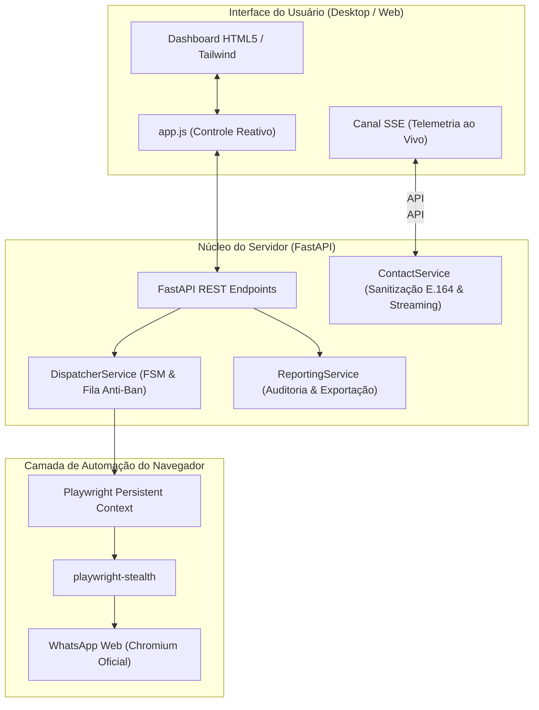

# WhatsApp Sender Engine 🚀

<div align="center">

[](https://www.python.org/)
[](https://fastapi.tiangolo.com/)
[](https://playwright.dev/)
[](LICENSE)
[]()

**Motor profissional e desacoplado de automação para disparo em massa via WhatsApp Web com simulação de comportamento humano biomecânico, proteção anti-ban estocástica (Box-Muller), persistência resiliente de sessão e ingestão de planilhas de alta performance.**

[🇧🇷 Português](README.md) • [🇺🇸 English](README.en.md)

</div>

---

## 📌 Por que o WhatsApp Sender Engine?

A maioria dos disparadores de WhatsApp do mercado falha devido a problemas estruturais conhecidos:
1. **Banimentos Imediatos da Meta:** Disparos realizados com intervalos robóticos estáticos (ex: exatamente a cada 5 segundos) ou automações sem digitação humana real acionam rapidamente os algoritmos de detecção de spam.
2. **Corrupção de Números de Telefone:** Planilhas do Excel frequentemente convertem números longos em notação científica (`6.299E+10`), removem o nono dígito brasileiro ou 'engolem' algarismos durante o parsing.
3. **Travamentos e Fugas de Memória:** Bibliotecas comuns carregam planilhas inteiras na memória, travando a máquina em listas com mais de 5.000 contatos.
4. **Perda de Conexão Contínua:** Sessões que exigem nova leitura de QR Code a cada reinício do software.

O **WhatsApp Sender Engine** foi arquitetado do zero para resolver definitivamente cada uma dessas falhas, combinando uma API assíncrona robusta em **FastAPI**, automação com **Playwright Chromium Stealth** e uma interface desktop moderna e fluida.

---

## ✨ Principais Funcionalidades

### 🛡️ 1. Proteção Anti-Ban Estocástica (Jitter de Box-Muller)
- **Eliminação de Assinatura Rítmica:** Os intervalos entre mensagens são gerados por amostragem gaussiana utilizando a Transformada de Box-Muller no intervalo $[10\text{s}, 25\text{s}]$, eliminando repetições periódicas previsíveis.
- **Injeção de Cauda Longa (Fat-Tail):** Chance estocástica de pausas aleatórias prolongadas (15s a 40s), quebrando classificadores estatísticos baseados em aprendizado de máquina.
- **Pausas Inteligentes por Lote:** Pausas aperiódicas configuráveis (ex: 2 a 5 minutos) a cada bloco de 20 envios.

### ⌨️ 2. Digitação Biomecânica Humana
- **Cadência Inter-Keystroke (IKI) Realista:** Digitação com velocidade variável baseada em palavras por minuto (WPM), com atrasos naturais diferenciados para pontuações fortes (`.`, `?`, `!`) e pausas curtas (`,`, `;`).
- **Simulação de Micro-Erros:** Introdução estocástica de digitação em teclas adjacentes do teclado QWERTY, com pausa de percepção, acionamento de `Backspace` e autocorreção.
- **Prevenção de Disparo Prematuro em Múltiplas Linhas:** Utilização de `Shift+Enter` para quebras de linha (`\n`), garantindo que textos estruturados em múltiplos parágrafos não sejam enviados prematuramente.

### 📊 3. Higienização e Sanitização Rigorosa E.164 (Brasil)
- **Validação de 67 DDDs Oficiais da Anatel:** Descarte imediato de DDDs fictícios ou inválidos.
- **Preservação e Restauração do 9º Dígito:** Resolução automática de números móveis (`62994912937` $\rightarrow$ `5562994912937`) e fixos (8 dígitos), além da remoção de CSPs (015, 021) e zeros de longa distância.
- **Blindagem contra Notação Científica do Excel:** Tratamento especializado de strings e floats para evitar truncamentos numéricos.
- **Deduplicação Determinística:** Algoritmo *First-Wins* que elimina duplicidades mantendo a integridade e consolidando variáveis adicionais.
- **Processamento em Streaming:** Ingestão de arquivos `.xlsx`, `.csv` e `.txt` em modo *streaming* (consumo constante O(1) de memória RAM $<15\text{MB}$ mesmo para mais de 50.000 linhas).

### 🌐 4. Automação WhatsApp Web com Playwright Stealth
- **Persistência de Sessão (`userDataDir`):** Armazenamento permanente de cookies, LocalStorage e IndexedDB; faça login via QR Code uma única vez e mantenha-se conectado.
- **Evasão Anti-Automação:** Flags avançadas do Chromium (`--disable-blink-features=AutomationControlled`), User-Agent autêntico do Chrome Windows e evasão via `playwright-stealth`.
- **Resiliência a Modais de Erro:** Detecção automática e clique de auto-dispensa no botão "OK" caso um número não possua WhatsApp ativo, registrando falha e continuando a fila sem travamento.

### 📝 5. Personalização com Spintax Multinível e Anexos
- **Spintax Recursivo:** Rotação dinâmica de variações textuais (`{Olá|Oi|E aí} {nome}!`) para que nenhuma mensagem enviada seja idêntica à anterior.
- **Interpolação de Variáveis:** Suporte a tags `{nome}`, `{telefone}`, `{empresa}`, `{valor}`, etc.
- **Envio de Mídia e Documentos:** Suporte a imagens, vídeos, PDFs e documentos Office com suporte a legenda personalizada.

### 📈 6. Telemetria SSE em Tempo Real & Relatórios Executivos
- **Streaming Server-Sent Events (SSE):** Monitoramento instantâneo do progresso, velocidade de envio e cálculo de ETA estocástico.
- **Exportação em 1 Clique:**
  - **Excel (`.xlsx`):** Colunas de telefone formatadas explicitamente como Texto (`@`) para evitar corrupção e aba secundária de *Resumo Executivo*.
  - **CSV (`.csv`):** Formato universal codificado em `utf-8-sig` (com BOM) e delimitador ponto e vírgula (`;`), pronto para abertura direta no Microsoft Excel.

---

## 🏛️ Arquitetura do Sistema



---

## 🚀 Instalação e Configuração

### Pré-requisitos
- **Python 3.10 ou superior** (recomendado Python 3.12)
- **Navegador Google Chrome** ou dependências do Chromium instaladas

### 1. Clonar o Repositório
```bash
git clone https://github.com/4pixeltechBR/whatsapp-sender-engine.git
cd whatsapp-sender-engine
```

### 2. Criar e Ativar Ambiente Virtual
```bash
# Windows
python -m venv .venv
.venv\Scripts\activate

# Linux / macOS
python3 -m venv .venv
source .venv/bin/activate
```

### 3. Instalar Dependências
```bash
pip install -r requirements.txt
playwright install chromium
```

### 4. Configurar Variáveis de Ambiente (Opcional)
Copie o arquivo de exemplo e ajuste se desejar:
```bash
cp .env.example .env
```

---

## 💻 Como Executar

### Opção 1: Via Script no Windows (1 Clique)
Basta clicar duas vezes em:
```text
Iniciar_WhatsApp_Sender.bat
```

### Opção 2: Via Terminal
```bash
python -m uvicorn app.main:app --host 127.0.0.1 --port 8765 --reload
```

Abra seu navegador e acesse:
👉 **`http://127.0.0.1:8765`**

---

## 🧪 Suíte de Testes e Garantia de Qualidade

O projeto possui cobertura extensiva de testes automatizados e testes de estresse adversarial:

```bash
# Executa todos os testes unitários e de integração
pytest -v

# Executa o Harness de Estresse Adversarial Tier 5 (10.000 linhas, locks de concorrência e abortos)
python tests/adversarial_tier5_harness.py

# Executa a Auditoria Sistemática de 5 Agentes
python tests/systematic_teamwork_audit.py
```

---

## 📂 Estrutura de Diretórios

```text
whatsapp_sender_engine/
├── app/
│   ├── core/
│   │   ├── config.py         # Configurações globais e diretórios
│   │   └── constants.py      # Enums de estado (FSM) e 67 DDDs da Anatel
│   ├── models/
│   │   └── schemas.py        # Modelos Pydantic de validação
│   ├── services/
│   │   ├── browser_service.py     # Automação Playwright Chromium
│   │   ├── contact_service.py     # Streaming, sanitização E.164 e deduplicação
│   │   ├── dispatcher_service.py  # Fila anti-ban, digitação biomecânica e Spintax
│   │   └── reporting_service.py   # Telemetria SSE e relatórios Excel/CSV
│   ├── static/
│   │   ├── css/styles.css    # Estilização moderna e modo escuro
│   │   ├── js/app.js         # Interface reativa e integração SSE
│   │   └── index.html        # Painel de controle completo
│   └── main.py               # Servidor FastAPI e rotas REST
├── data/                     # Dados persistentes locais (ignorado no git)
│   ├── session/              # Perfil persistente do Playwright (IndexedDB)
│   ├── uploads/              # Planilhas e anexos temporários
│   └── reports/              # Relatórios exportados
├── tests/                    # Suíte completa de testes e auditorias
├── .env.example              # Exemplo de configuração
├── .gitignore                # Proteção contra commit de dados de sessão
├── Iniciar_WhatsApp_Sender.bat # Script de inicialização rápida
├── LICENSE                   # Licença MIT
├── README.md                 # Documentação em Português
├── README.en.md              # Documentação em Inglês
└── requirements.txt          # Dependências do projeto
```

---

## 📄 Licença

Distribuído sob a licença **MIT**. Veja [`LICENSE`](LICENSE) para mais informações.

Desenvolvido com excelência por **[4Pixel Tech](https://github.com/4pixeltechBR)**.
